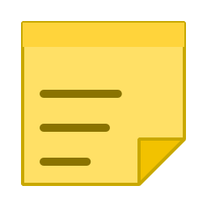

# JUN_Memo

Windows 10 · 11 의 **스티커 메모(Sticky Notes)** 처럼 쓰는 독립 실행 메모 앱 (PySide6).
노트 하나하나가 **바탕화면에 붙는 작은 색 창**이고, 노트 목록에서 골라 다시 연다.



- **버전**: `app/config/version.py` (v01.07 — Shared 파랑 / This PC 초록 배지 · v01.06 — **고른 글자만 크기**(T− / T+) · 목록 버튼이 잘 보이게 · v01.05 — **글자 크기**(노트마다 · 목록) · v01.04 — 목록 창 **Shrink**(움직이는 아이콘) · v01.03 — 끌어 고른 영역이 보이게 · **Push Shared** 버튼 · v01.02 — 범위 라디오 버튼이 잘 보이게 · v01.01 — 목록 창 색 · Pin, 공유(GitHub) / 이 PC 노트, 시작 메뉴 · 작업 표시줄) · 변경 기록 [`CHANGELOG.md`](CHANGELOG.md)
- **필요한 것**: Python 3.9+ · `pip install -r requirements.txt` (PySide6)
- **실행**: `Run_JUN_Memo.bat` 더블클릭(콘솔 창 없이) 또는 `pythonw launch.py`

---

## 1. 화면

```
 노트 목록                                  노트 (스티커)
┌───────────────────────────┐            ┌─────────────────────────────┐
│ Sticky Notes  [+][Pin][…] │            │ +                Pin  …  ✕  │ ← 색 띠: 잡고 끌면 이동
│ [Search...              ] │            │ Today                       │
│ ┌───────────────────────┐ │  클릭 →    │  • Rig review 2pm           │
│ │              10:25    │ │            │  • Fix A00630 hover         │
│ │ Today                 │ │            │ Buy coffee beans            │
│ │ Rig review 2pm        │ │            │                             │
│ └───────────────────────┘ │            │ B  I  U  S  •            ◢ │ ← 서식 · 크기 손잡이
│ 3 note(s)                 │            └─────────────────────────────┘
└───────────────────────────┘
```

### 노트 목록
- **`+`** (Ctrl+N) — 새 노트. 기본 색은 **저장된 노트 색** — 마지막으로 고른 노트 색(v01.08, 처음엔 노랑). 필터가 `Shared` 면 공유 노트로 만든다.
- **`Shrink`** (v01.04) — 목록 창을 **272 x 155** 로 줄이고 **움직이는 아이콘**(색 스티커가 떨어져 → 연필이 세 줄 쓰고 → 압정 → 날아가고 다음 색, 끝없이 반복)과
  `Shrunk` · `Pin` 만 남긴다(Shrunk 는 켜져도 빨갛지 않다). 아이콘을 클릭하거나 `Shrunk` 를 누르면 원래 크기 · 검색어 · 필터 그대로 펴진다. 줄인 채 끄면 줄인 채로 켜진다.
- **`Pin`** — 목록 창을 늘 맨 위에(켜지면 `Pinned` · 연한 빨강). 줄인 동안에는 Shrunk 아래.
- **`…`** — 목록 창 **색**(7색 견본 · `Custom list color...`) · `Reload shared notes` · **`Add to Start Menu`** · `Pin to Taskbar` (4장).
  목록 창은 모든 부분(배경 · 글자 · 검색칸)을 고른 색으로 칠한다 — 윈도우 다크 모드에서도 글자가 보인다. 색 · Pin · 자리는 기억.
- **`Push Shared`** (아래) — 공유 노트만 GitHub 로 (3장).
- **글자 크기** (v01.05) — 목록 위에서 Ctrl + 휠, `…` > Larger / Smaller / Reset text size.
- **All / Shared / This PC** — 범위로 거르기(3장). 카드의 배지 · 왼쪽 띠 색으로도 구분 — Shared 파랑, This PC 초록. 고른 것은 원 안에 점 · 굵은 글자. 카드 왼쪽 위에 범위 표시.
- **Search** — 적은 낱말이 **모두** 들어 있는 노트만(대소문자 무시).
- 카드 = 노트의 색 · 앞부분 3줄 · 마지막으로 고친 시각(오늘이면 시:분), 📌 = Pin.
- **카드를 클릭하면 그 노트가 스티커 창으로 열린다.** 이미 열려 있으면 앞으로 나온다.
- 우클릭 — Open · Color(7색) · Delete.
- **카드를 위아래로 끌어 놓으면 순서가 바뀐다**(v01.08, 이 PC 에 기억). 검색 · 범위로 걸러 둔 채 옮기면 보이던 노트들끼리만 자리가 바뀐다.
  한 번도 끌지 않았으면 최근에 고친 노트가 위, 새 노트는 늘 맨 위.

### 노트 (스티커 창)
| 자리 | 동작 |
|------|------|
| 위쪽 색 띠 | 잡고 끌면 창이 움직인다 |
| `+` (Ctrl+N) | 이 노트 옆(오른쪽 아래로 조금)에 새 노트 |
| **`Pin`** | **늘 다른 창 위에**. 켜지면 `Pinned` · 연한 빨강. 다시 누르면 해제 |
| `…` | **색 견본 7개**(Yellow · Green · Pink · Purple · Blue · Gray · Charcoal) · `Custom color...`(아무 색) · **`Shared (GitHub)`** 켜고 끄기 · Notes list · Delete note |
| 띠 왼쪽 `Shared` / `This PC` | 이 노트의 범위 (3장) — **Shared = 파랑, This PC = 초록** 배지(v01.07) |
| `✕` | 닫기 — 노트는 목록에 남는다. **빈 노트는 닫을 때 지운다** |
| 아래 `T− T+` (v01.06) | **끌어서 고른 글자만** 한 단계 작게 / 크게 (작게 · 보통 · 크게 · 더 크게 · 가장 크게), Ctrl+Shift+, / Ctrl+Shift+. — 노트 전체 배율과 곱해진다. 고른 것이 없으면 이어서 칠 글자 |
| 아래 `A− 100% A+` (v01.05) | 글자 크기 60 ~ 300% (Ctrl + 휠 · Ctrl+= / − / 0, 퍼센트 클릭 = 100%). 노트마다 이 PC 에 기억 |
| 아래 `B I U S •` | 굵게 (Ctrl+B) · 기울임 (Ctrl+I) · 밑줄 (Ctrl+U) · 취소선 (Ctrl+T) · 글머리표 (Ctrl+Shift+L, 다시 누르면 해제) |
| 오른쪽 아래 ◢ | 끌어서 크기 |

- 붙여 넣기는 **글자만** 들어온다 — 웹 · 워드에서 복사한 배경색 · 큰 글꼴이 색 노트를 깨지 않게.
- 사용자 색: 띠는 조금 어둡게, 글자는 바탕 밝기에 따라 검정 / 흰색이 저절로 정해진다.

## 2. 저장

- 이 PC 노트 · 공유 노트가 따로 저장된다 — 3장.
- **자동 저장** — 글을 칠 때마다가 아니라 멈추고 0.5초 뒤, 그리고 노트를 닫을 때 · 앱을 끌 때 바로.
- 파일: **`%APPDATA%\JUN_Memo\notes.json`**(이 PC 노트의 내용 · 색 · 만든 / 고친 시각) + **`state.json`**(모든 노트의 열림 · 창 자리 · 크기 · Pin, 목록 창 색 · Pin · 자리, 목록 순서 · 새 노트 기본 색).
  쓰기는 임시 파일 → 한 번에 바꾸기라 쓰다 꺼져도 깨지지 않고, 직전 파일을 `notes.json.bak` 으로 하나 남긴다(깨졌으면 그것을 읽는다).
- **다시 켜면 열려 있던 노트가 그 자리 · 크기 · 색 · Pin 그대로 다시 열린다.** 저장된 자리가 지금 어느 화면에도 없으면(모니터를 뺐을 때) 주 화면으로.
- **한 번만 실행** — 이미 떠 있을 때 다시 실행하면 새로 뜨지 않고, 떠 있는 앱의 노트 목록이 앞으로 나온다.
- 모든 창(목록 · 노트)을 닫으면 앱이 끝난다.

## 3. 공유 노트 (GitHub) / 이 PC 노트 (v01.01)

| 범위 | 내용이 있는 곳 | 누가 본다 |
|------|----------------|-----------|
| **Shared** | 저장소 안 **`shared/notes/<id>.json`** (노트 하나 = 파일 하나) | git 으로 올리고 받은 모든 PC |
| **This PC** | `%APPDATA%\JUN_Memo\notes.json` | 이 컴퓨터만 |

- 노트 `…` > `Shared (GitHub)` 로 바꾼다(파일이 옮겨진다). 목록 카드와 노트 띠에 표시.
- **창 자리 · 크기 · 열림 · Pin 은 공유하지 않는다** — PC 마다 화면이 달라서 `%APPDATA%\JUN_Memo\state.json` 에 둔다.
  그래서 창을 옮기거나 Pin 해도 공유 파일은 바뀌지 않는다(git 에 쓸데없는 변경이 안 생긴다). 공유 파일 = 내용 · 색 · 만든 / 고친 시각.
- 노트마다 파일이 따로라 **두 PC 가 다른 노트를 고치면 git 충돌이 없다.** 같은 노트를 두 곳에서 고쳤을 때만 충돌한다.
- **올리기 = 목록 창 아래 `Push Shared` 버튼** (v01.03) — 열린 노트를 저장하고 **`shared/notes` 만** 커밋해 GitHub 로 푸시한다.
  - 고치는 중인 다른 파일 · 이 PC 노트는 안 올라간다(경로를 정해 커밋). 커밋 메시지 `notes: update N shared note file(s)`.
  - 다른 PC 가 먼저 올렸으면 받아서(`git pull --rebase --autostash`) 다시 푸시하고, 받은 공유 노트를 목록에 읽어 들인다.
  - 브랜치에 아직 안 올라간 **다른 커밋**(코드 등)이 있으면 그것까지 나가므로 **푸시하지 않고** 알린다 — 그 커밋을 먼저 올린 뒤 다시 누른다.
  - 바뀐 것이 없으면 "nothing to push". git 이 설치돼 있고 GitHub 로그인(Git Credential Manager)이 돼 있어야 한다.
- 받기만 할 때는 `git pull` 뒤 목록 `…` > `Reload shared notes`.
- `Reload shared notes` 는 열어 둔 공유 노트는 손대지 않는다(고치는 중인 글이 바뀌지 않게) — 닫고 다시 읽으면 바뀐다.
- **주의**: 공유 노트는 GitHub 저장소에 그대로 올라간다. 저장소가 공개면 누구나 본다 — 개인적인 것은 This PC 로.

## 4. 시작 메뉴 · 작업 표시줄 (v01.01)

목록 창 `…` 메뉴 (`0110_JUN_Video_Tool` 과 같은 방식):

- **`Add to Start Menu`** — 시작 메뉴 `모든 앱` 에 **JUN Memo** 바로가기를 만들고(pythonw 로 실행 = 콘솔 창 없음, 아이콘 · 앱 ID 포함) 시작 화면 고정을 시도한다.
  고정이 안 보이면 시작 > 모든 앱 > JUN Memo 우클릭 > `시작 화면에 고정`. **폴더를 옮겼으면 다시 누른다**(경로 갱신).
- **`Pin to Taskbar`** — 고정을 시도하고, Windows 10 1809+ / 11 처럼 프로그램이 스스로 고정하는 것을 막는 곳이면
  "작업 표시줄의 JUN Memo 버튼 우클릭 → 작업 표시줄에 고정" 을 안내한다. 그 버튼은 python 이 아니라 JUN Memo 를 실행한다.

## 5. 구조

```
JUN_Memo/
├── launch.py              # 실행 · 한 번만 실행(QLocalServer) · 작업 표시줄 아이콘(AppUserModelID) · 아이콘 그리기
├── Run_JUN_Memo.bat       # pythonw 로 실행
├── app/config/version.py
├── app/core/store.py      # 노트 저장소(이 PC + 공유) · 색 팔레트 · 미리보기 (Qt 비의존)
├── app/core/git_sync.py   # Push Shared - 공유 노트만 커밋 · 푸시 (v01.03)
├── app/core/shell_integration.py  # 시작 메뉴 바로가기 · 고정 · 창 재실행 정보 (Video Tool 에서 옮김)
├── app/ui/note_window.py  # 스티커 창
├── app/ui/memo_anim.py    # Shrink 동안의 아이콘 애니메이션 (v01.04)
├── app/ui/list_window.py  # 노트 목록 창
├── app/ui/controller.py   # 목록 · 노트 창 · 저장 잇기 (자동 저장, 빈 노트 지우기, 다시 열기)
├── icon/JUN_Memo.ico · .png
├── shared/notes/          # 공유 노트 (<id>.json, git 으로 올라간다)
└── tests/test_memo.py · test_scope_list.py · test_push_shared.py · test_shrink.py · test_text_size.py · test_selection_size.py · test_scope_colors.py · test_default_color.py · test_reorder.py   # 오프스크린 시험 (push 는 임시 git 저장소로)
```

## 6. 시험

`python tests/test_memo.py` · `python tests/test_scope_list.py` — **44 + 31 + 20 + 19 + 19 + 17 + 9항목**(`test_push_shared.py` 는 실제 git 으로, 임시 원격 + 클론 둘). 공유 폴더는 시험 동안 임시 폴더(`JUN_MEMO_SHARED`). test_memo(오프스크린 PySide6): 저장소(내용 · 순서 · 검색 · 저장/다시 읽기 · 깨진 파일 → 백업 · 팔레트),
노트 창(자리 · 색 · Pin 플래그 · 굵게 · 글머리표 켜고 끄기 · 붙여 넣기 글자만), 앱 흐름(새 노트 · 자동 저장 · 빈 노트 지움 · 닫아도 목록에 남음 ·
목록 클릭 = 그대로 다시 열기 · 검색 · 색 바꾸기 · 다시 켜면 다시 열림 · 화면 밖 자리 → 주 화면 · 삭제), 한 번만 실행.

**실제 화면 확인은 아직** — 창 끌기 · 크기 손잡이 · Pin 이 다른 앱 위에 남는지 · 작업 표시줄 아이콘.

## 7. 원본과의 관계

Microsoft 스티커 메모의 **쓰임새(색 · 목록 · 붙는 창)** 를 따라 새로 만든 것이다 — 그 앱의 코드 · 그림은 쓰지 않았다.
색 값은 스티커 메모의 7색에 가깝게 골랐다.
